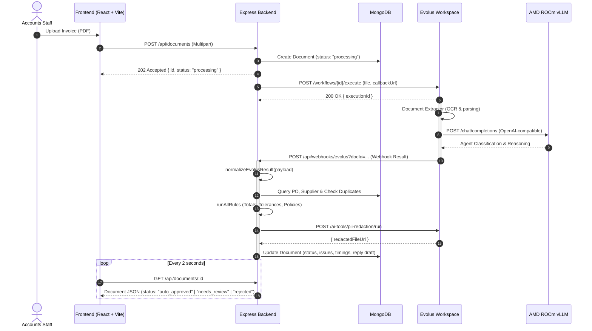

# Architecture Overview

<!-- Owned by Ammar -->

The **Supplier Document Desk** automates accounts payable document validation (invoices and delivery notes) by orchestrating an open-source agent served on AMD Developer Cloud (ROCm) with Evolus enterprise AI building blocks, tied together by a deterministic TypeScript/Node.js rules engine.

---

## Evolus Integration

Our Node.js backend drives Evolus through its REST API using an isolated adapter pattern ([`backend/src/services/evolusClient.js`](file:///e:/Web%20Development/Hackaton%20Projects/Supplier%20Document%20AMD%20III%20Hackathon/supplier-document-desk/backend/src/services/evolusClient.js)).

### Workflow Architecture
1. **Document Upload**: The user uploads an invoice/delivery note via the web dashboard.
2. **Evolus Workflow Trigger**: The backend starts an asynchronous Evolus workflow with `POST /workflows/{id}/execute` and provides a unique callback webhook (`PUBLIC_BASE_URL + /api/webhooks/evolus?docId=...`).
3. **Extraction & Agent Intelligence**: Inside Evolus, the Document Extractor converts unstructured PDF data into structured fields and confidence scores. The open agent hosted on **AMD Developer Cloud (vLLM ROCm)** evaluates descriptions and contextual nuances.
4. **Asynchronous Webhook / Polling Fallback**: Once Evolus completes execution, it invokes our webhook. If incoming webhooks are obstructed in local environments, a non-blocking background poller queries execution status every 2 seconds.
5. **Deterministic Rule Engine**: Code performs 100% of the mathematical calculations, tolerance verification, PO cross-matching, and duplicate checks.
6. **PII Redaction Tool**: Evolus AI Tool masks personal details (bank account numbers, personal contacts) before generating the shareable document link.

### Sequence Diagram

---

## Core Principles
1. **Code Does the Math**: LLMs never compute line sums, tax amounts, or tolerances.
2. **Graceful Fallbacks**: If webhooks fail, polling activates automatically. If live services are offline, mock mode keeps the frontend working.
3. **No Secret Leakage**: API keys and auth headers are sanitized from all logs and error messages.
